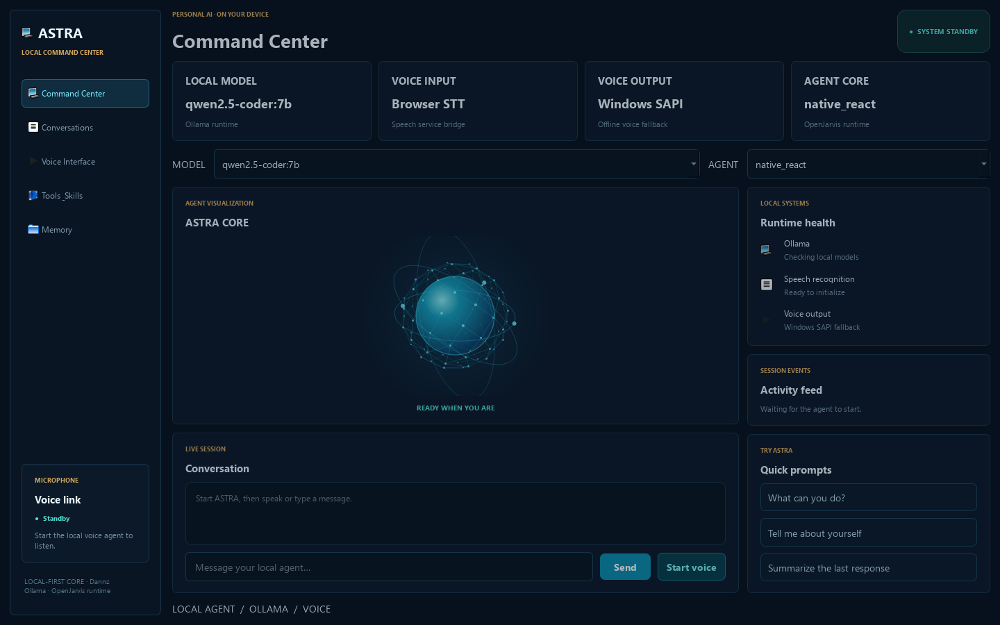

# ASTRA: Local AI Command Center

> A local-first desktop assistant with an animated command center, persistent memory, tool-using agents, Ollama models, voice input/output, and Windows automation.

[](https://www.python.org/)
[](LICENSE)
[](https://github.com/AnubhavChaturvedi-GitHub/jarvis-ai-assistant/stargazers)
[](https://github.com/AnubhavChaturvedi-GitHub/jarvis-ai-assistant/network/members)



## What it does

ASTRA is a local-first Python assistant. It routes requests through OpenJarvis agents and tools, controls supported desktop workflows, and responds through text or voice.

## Features

| Module | What it gives you |
| --- | --- |
| `NetHyTechSTT` | Local speech-to-text via Vosk (offline, no paid API) |
| `TextToSpeech` | Natural spoken replies via Windows SAPI (COM + pyttsx3 fallback) |
| `OpenJarvis` / `jarvis_runtime.py` | Agent runtime, tool execution, model discovery, and conversation context |
| `Brain` / `co_brain.py` | Desktop intent routing, legacy system integrations |
| `Real_Time` | Live web search so answers are not limited to training data |
| `TextToImage` | Generate images from a spoken prompt |
| `Vision` | Camera capture and image understanding |
| `Automation` | Open apps, control the desktop, run system tasks |
| `Whatsapp_automation` | Send WhatsApp messages hands free |
| `Weather_Check` | Live weather by location |
| `Time_Operations` | Alarms, reminders and scheduling |
| **NEW** `Brain/multistep_planner.py` | Durable multi-step task planning with execution journaling |
| **NEW** `Brain/google_workspace.py` | Gmail, Calendar, Drive, Docs, Sheets, Slides, Tasks via OAuth |
| **NEW** `Brain/barge_in.py` | Acoustic barge-in detection for full-duplex interruption |
| **NEW** `Brain/agent_loop.py` | ReAct agent with tool use, observation, journal persistence, resume |
| **NEW** `Brain/orb_bridge.py` | Python ↔ Three.js visualizer real-time bridge |
| **NEW** `Security/` | PIN, password, face, fingerprint, Windows Hello, liveness detection |
| **NEW** `public/` | Three.js/WebGL Orb Visualizer with GLSL shaders |
| **NEW** `astra_ui/` | Upgraded PyQt OrbVisualizer with 13 profiles, FFT, particles |
| **NEW** `web_bridge.py` | aiohttp + WebSocket server for web visualizer + orb bridge |

## Getting started

### Prerequisites

- Python 3.10 or newer
- Ollama with a local model (default: `qwen2.5-coder:7b`)
- A working microphone and speakers
- Google Chrome (used by the browser automation modules)
- Windows 10/11 (for SAPI TTS and UIA automation)

### Installation

```bash
git clone https://github.com/AnubhavChaturvedi-GitHub/jarvis-ai-assistant.git
cd jarvis-ai-assistant
py -3.11 -m venv .venv
.venv\Scripts\python -m pip install -r requirements.txt
```

### Vosk model (required for STT)

Download a Vosk model and place it in the project root:

```bash
# English (small, ~40 MB)
python download_vosk_model.py small-en-us-0.15

# Vietnamese (small, ~40 MB)
python download_vosk_model.py small-vn-0.4
```

### Run it

```bash
# Desktop command center (Qt UI)
.venv\Scripts\python ui.py

# Voice-only entry point
.venv\Scripts\python jarvis.py
```

The desktop command center provides direct text chat without starting the microphone, selectable local models and agents, tool controls, a live activity feed, session history, and editable OpenJarvis memory. The default agent is `native_react`; select `orchestrator` for the alternate planner.

To enable WhatsApp sending, configure your own number in PowerShell before launch:

```powershell
$env:ASTRA_DANNZ_WHATSAPP = "+<country-code><phone-number>"
```

## Usage

Say the wake word, then speak naturally:

- "What is the weather in Bangalore?"
- "Open Chrome and search for transformer architecture"
- "Generate an image of a red sports car at sunset"
- "Send a WhatsApp message to Rahul saying I am running late"
- "What is happening in the news right now?"

### Google Workspace (optional)

Set up OAuth credentials and place them at `~/.astra/google_credentials.json`. The first run will open a browser for consent.

Supported services:
- Gmail (search, read, draft, send)
- Calendar (list, create, update, delete events)
- Drive (search, upload, download)
- Docs (create, read, append)
- Sheets (create, read, append)
- Slides (create)
- Tasks (list, create)

### Three.js Orb Visualizer (experimental)

Open `public/index.html` in a browser for the WebGL neural core visualizer with:
- 13 state profiles (idle, listening, thinking, speaking, etc.)
- GLSL shader plasma surface
- Audio-reactive particles
- Frequency band visualization

## Project structure

```text
jarvis.py              entry point, intent routing
ui.py                  desktop Qt command center
co_brain.py            reasoning and conversation memory
jarvis_runtime.py      OpenJarvis bridge with model routing
web_bridge.py          aiohttp + WebSocket server (web visualizer + orb bridge)
Brain/                 core brain modules
  agent_state.py       state machine + event bus
  conversation_context.py  follow-up + working context
  memory_store.py      SQLite + lexical/embedding retrieval
  task_store.py        persistent multi-step tasks
  model_router.py      local model selection
  tool_registry.py     typed tools with permission gates
  local_tool_router.py regex fast-path for file/app intents
  speech_turn.py       partial transcript + end-of-turn
  voice_activity.py    WebRTC VAD + RMS fallback
  logger.py            centralized logging
  barge_in.py          acoustic full-duplex detection
  multistep_planner.py durable multi-step execution
  google_workspace.py  Gmail/Calendar/Drive/Docs/Sheets/Slides/Tasks
  orb_bridge.py        Python ↔ Three.js visualizer bridge
  agent_loop.py        ReAct agent with tool use, journal, resume
Security/              authentication & biometrics
  auth_manager.py      central auth orchestration
  pin_auth.py          PIN hashing/verification
  secure_storage.py    encrypted profile storage
  face_recognition.py  face enrollment/verification
  fingerprint.py       fingerprint via Windows Biometric Framework
  liveness.py          anti-spoofing detection
  winbio_wrapper.py    Windows Hello integration
  login_ui.py          login UI components
astra_ui/              upgraded PyQt components
  core/theme.py        stylesheet, colors, mode stylesheet
  widgets/orb.py       OrbVisualizer (13 profiles, FFT, particles)
  widgets/panels.py    Card, MetricCard, HealthRow
  assets.py            asset loading
NetHyTechSTT/          Vosk offline STT
TextToSpeech/          Windows SAPI + pyttsx3 fallback
Automation/            desktop/app control + UIA + Office COM
  office_automation.py Word/Excel/PowerPoint via COM
  windows_uia.py       UIA accessibility adapter
  Youtube_play_back.py media key controls for YouTube/browser
Features/              file agent, system utils
public/                Three.js/WebGL orb visualizer
  index.html           main visualizer entry
  orb.js               Three.js + GLSL shader core
  audio.js             Web Audio API barge-in + model router
  planner.js           multistep execution journaling
  workspace.js         Google Workspace mock clients
```

## Tech stack

Python, SpeechRecognition (Vosk), Selenium, PyWhatKit, OpenCV, Requests, Tkinter/Qt, pyttsx3, comtypes, pywin32, pywinauto, google-api-python-client, ollama.

## Contributing

Issues and pull requests are welcome. Fork the repo, create a feature branch, and open a PR describing what changed and why.

## License

Released under the [MIT License](LICENSE).

## Owner

**Owner:** Dannz

If this project saved you time, a star on the repo helps other people find it.